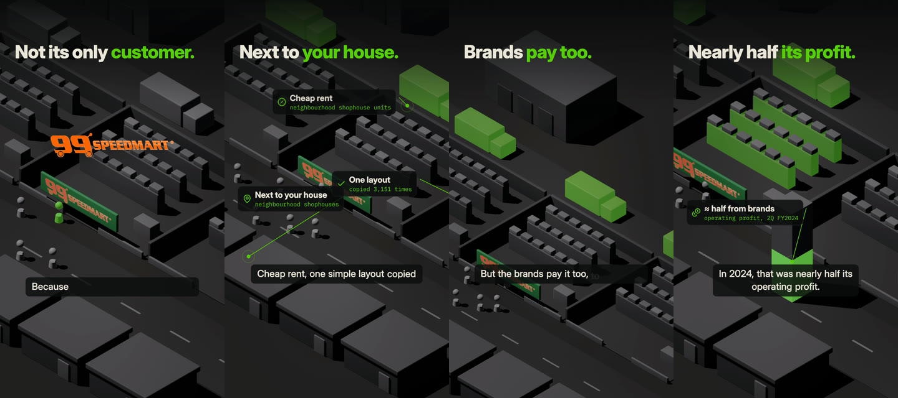
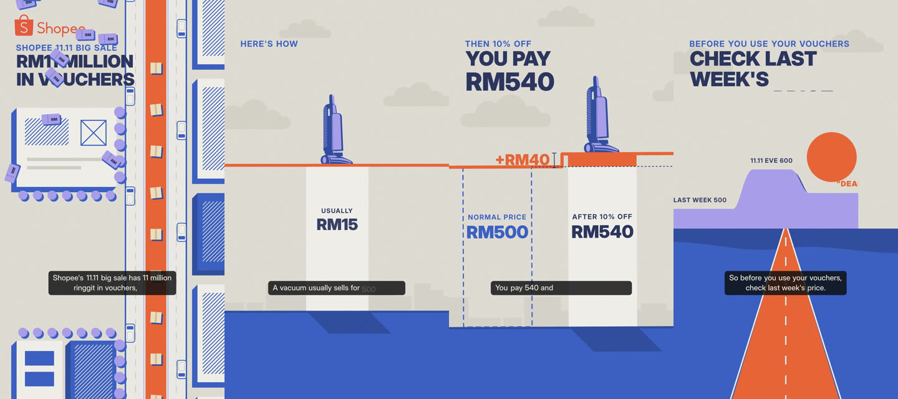
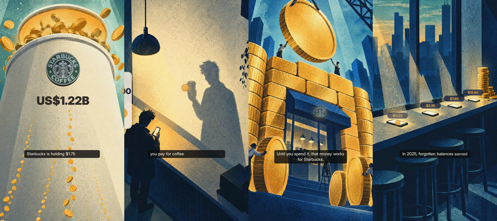

# Series bible — what to collect, and how

**Goal:** one look per style that holds for a whole series, so every episode feels like the same show. You collect
references; I judge every one against what I can actually produce and turn them into a bible per style (rules + a master
prompt + test frames). Three styles compete on performance, so each gets its own look references.

Time: about 2–3 hours per style for the priority folders. Quality beats quantity. **Start with the style you love most;**
the others can follow.

---

## The three styles: which one are you collecting for?

### Style A — smooth iso (3D clay world, dark)

*EX25 99 Speedmart.* A small 3D world seen from above at an angle (isometric), matte clay surfaces, dark ground, **one green
accent**, clean UI callouts with a thin leader line. Built by me in Blender/raea. Feels: calm, precise, "how the system works".
**You're looking for:** 3D renders and miniatures, not drawings.

### Style B — flat geometry (vector shapes, light paper)

*EX27 Shopee 11.11.* Flat 2D shapes, no texture, 4 colours on light paper, a new **viewpoint per beat** (top-down map →
side view → horizon), one through-line (the orange price line), bold headline type, shape-built transitions. Drawn by me
in code. Feels: graphic, clever, poster-like. **You're looking for:** flat vector design and motion graphics.

### Style C — illustrated plates (grain, light, cinematic)

*EX26 Starbucks.* Painted editorial illustrations **generated by you**, used whole; the camera moves through them with
depth; grain-stippled light; cool palette with **one warm accent that means money**; tiny people, giant objects;
shadows that tell the story. Feels: cinematic, moody, "a short film". **You're looking for:** editorial illustration and
film stills with strong light.

---

## The 7 rules of collecting

1. **One main source per style.** Find 1–3 artists or studios whose work feels like "our show" and take many images from
   *them*. Twenty images from one artist teach a consistent look; twenty from twenty artists teach nothing.
2. **Always keep the link and the artist.** When an image grabs you, open the artist's profile: their other work is
   usually the best next 10 references.
3. **Write one line per image: what you like about it.** Use the words at the bottom (light, colour, scale, crop, texture…).
   "I like the light" is enough. This line matters more than the image.
4. **Full size, not thumbnails** (aim for 1500 px or more). No screenshots of Pinterest grids.
5. **Skip AI-generated images.** Signs: no artist named, six fingers, melted text, glossy "too smooth" look.
6. **Collect what you dislike too** (folder 10). "Never this" is as useful as "this".
7. **Don't worry whether I can make it.** Collect what you love; sorting by what's possible is my job.

## Where to look

| Site | Best for |
|---|---|
| **Behance** (behance.net) | Full projects by one artist: best for the core look (A, B, C) |
| **ArtStation** (artstation.com) | Concept art, 3D renders, light, colour scripts (A, C) |
| **Dribbble** (dribbble.com) | Flat vector and isometric illustration (A, B) |
| **Pinterest** | Fast discovery; always click through to the original artist |
| **Instagram** | Illustrators and 3D artists post series there |
| **FILMGRAB** (film-grab.com) | Free stills from real films: camera angles and lighting (C) |
| **Art of the Title** (artofthetitle.com) | Title sequences: motion, transitions, type (B, C) |
| **Vimeo** (search + "Staff Picks") | Motion design and animation clips (A, B, C) |
| Your phone | Real Malaysian places, signs, light at night (all) |

## How to save

- **Core look:** into the style's own folder: `refs/01_core-look/A_smooth-iso/`, `B_flat-geometry/` or `C_illustrated-plates/`.
- **Everything else:** into the shared category folder (`refs/02_light/` … `refs/10_dont-like/`), with the **style letter
  first** in the file name: `C_02_malikafavre_shadow.jpg`, `A_05_myphoto_99speedmart.jpg`. Use `X_` if it fits every style.
- **Notes:** one `notes.md` per folder, one line per image:

```
C_02_malikafavre_shadow.jpg | https://www.behance.net/... | Malika Favre | the shadow shape tells the story; only 2 colours
```

For clips (folder 08) save only the link and time: `B | https://vimeo.com/... @0:12–0:18 | the line becomes the road`.

---

## What to collect (★ = priority)

### ★ 01_core-look — the look of the show (20–40 per style)
The single most important folder. Mostly from 1–3 artists per style.

| Style | Search terms | Look for |
|---|---|---|
| **A** | `isometric 3D illustration` · `3D isometric diorama` · `clay render` · `matte clay 3D` · `miniature city 3D` · `dark 3D illustration` · `isometric room blender` · `3D infographic` | matte surfaces, soft shadows, one accent colour, tidy small worlds, dark or neutral ground |
| **B** | `flat geometric illustration` · `geometric vector illustration` · `flat design motion graphics` · `bauhaus illustration` · `swiss design poster` · `flat map illustration` · `vector infographic` · `minimal poster design` | 3–5 flat colours, no texture or gradients, bold shapes, strong type, clever viewpoint |
| **C** | `editorial illustration grain texture` · `editorial illustration light and shadow` · `chiaroscuro illustration` · `noir illustration` · `risograph illustration` · `textured vector illustration` · `magazine cover illustration` · `cinematic illustration` | grain/stipple texture, strong light, few colours, small people in big spaces, empty space |

### ★ 02_light — how light behaves (10–15 per style)

| Style | Search terms |
|---|---|
| **A** | `soft studio lighting 3D render` · `rim light 3D render dark` · `ambient occlusion clay` · `emissive glow 3D` |
| **B** | `long shadow flat design` · `flat illustration shadow shapes` · `two-tone shading vector` (B has almost no light: collect only if you want more) |
| **C** | `light shafts illustration` · `volumetric light illustration` · `neon night illustration` · `golden hour illustration` · `phone light face illustration` · `window light interior illustration` · `film noir lighting`. On FILMGRAB: Wong Kar-wai films (e.g. *In the Mood for Love*), *Blade Runner 2049*, *Drive*, *Her* |

### ★ 05_places — where our stories happen, Malaysia first (15–30, shared)
Half real photos (yours are perfect), half drawn or 3D versions in the style you're collecting.
**Real places, all styles:** `mamak` · `kopitiam` · `shophouse` · `Kuala Lumpur night` · `hawker centre` · `pasar malam` ·
`LRT station Kuala Lumpur` · `petrol station night` · `mall atrium` · `convenience store`.
**Add the style word:** A → `… isometric 3D` (e.g. `isometric shophouse 3D`) · B → `… flat illustration` ·
C → `… illustration night` (e.g. `kopitiam illustration night`).
**Phone photos:** inside a 99 Speedmart, a mamak at night, a petrol kiosk, an LRT platform, a shop counter, signboards.
Shoot wide and straight, at the times of day you like the light.

### ★ 04_people — how figures look (10–15 per style)
Our people **hold poses** (never walk or gesture), so look at silhouettes, proportions, clothing and how much face shows.

| Style | Search terms |
|---|---|
| **A** | `3D figurine character` · `clay character 3D` · `faceless 3D character` · `isometric people 3D` · `minimal 3D avatar` |
| **B** | `geometric character design` · `flat vector people minimal` · `faceless flat character` · `shape-based character` |
| **C** | `silhouette illustration people` · `faceless character illustration` · `editorial illustration people` · `character model sheet` |
| **All** | `Southeast Asian character illustration` · `Malaysian character illustration` · `hijab character illustration` · `office worker illustration` · `hawker illustration` |

**Note in your line:** face shown or not, realistic or stylised proportions, local clothing you want to see.

### ★ 07_camera — angles and framing (10–20, shared)
For the *view*, not the style. **Search (filmmaker terms):** `worm's eye view` (looking up from the floor) · `bird's eye view`
/ `top-down shot` · `high angle shot` · `low angle shot` · `over the shoulder shot` · `extreme close-up` ·
`wide establishing shot` · `dutch angle` (tilted) · `forced perspective` · `scale contrast illustration` (tiny people,
giant objects) · `frame within a frame` · `negative space composition`.
Style extras: A → `isometric camera`, `orthographic view`, `tilt-shift` · B → `side elevation illustration`,
`one-point perspective flat`, `cross-section illustration`.

### 03_colour — colour mood across a film (5–10)
**All:** `color script` · `Pixar color script` · `limited color palette`. A → `dark mode color palette`, `monochrome with accent` ·
B → `four color palette design`, `bauhaus color palette` · C → `duotone illustration`, `night city color palette`.

### 06_props — the objects that keep coming back (5–10)
Phones, coins, receipts, shop signs, cups, price tags. A → `3D icon clay`, `3D object render matte` · B → `flat icon set
geometric`, `vector object illustration` · C → `object illustration grain`, `still life editorial illustration`. All →
`prop design sheet`, `money illustration`.

### 08_motion — how things move and hand over (5–10 clip links)
A → `3D isometric animation`, `3D explainer animation`, `camera move isometric` · B → `flat motion graphics`,
`shape transition`, `kinetic typography`, `TomTom ad animation` · C → `2.5D parallax animation`, `illustration animation
parallax`, `editorial animation`. All → `match cut`, `graphic match transition`, `title sequence`.
Studios to browse: **Buck**, **Ordinary Folk**, **Giant Ant**, **Oddfellows**. Note the exact seconds you like.

### 09_type — on-screen text (optional, 3–5)
`editorial magazine typography` · `infographic callout design` · `data label design` · B → `bold sans poster typography`.

### 10_dont-like — never this (5–10)
Anything that feels cheap, generic, "corporate explainer", AI-glossy. One line on why, and which style it's a warning for.

---

## Words for your notes

| Word | Meaning |
|---|---|
| **composition** | how things are arranged in the frame |
| **scale** | big vs small (a tiny person next to a giant object) |
| **crop** | what the frame cuts off; a bold crop shows only part of something |
| **negative space** | the empty area that makes the subject stand out |
| **palette** | the set of colours used |
| **accent** | the one colour that pops against the rest |
| **contrast** | difference between light and dark (high = dramatic) |
| **silhouette** | a shape filled dark against light |
| **texture / grain** | the dotty, printed feel on flat colour (C), or the surface of a 3D material (A) |
| **matte / glossy** | dull vs shiny surface (A) |
| **isometric** | seen from above at an angle with no perspective, like a game board (A) |
| **flat** | no shading or texture, pure colour shapes (B) |
| **rim light** | a thin line of light along an edge |
| **mood** | the feeling (calm, tense, lonely, warm…) |
| **angle** | where the camera looks from (low, high, top-down) |
| **depth** | how much near vs far is felt (layers, haze) |

---

## What I do once you've collected

1. **Read every image + note per style**, and find the common thread.
2. **Judge each against what I can produce**, in three groups:
   - **Adopt** — I can make it as is (A: Blender/raea models, materials, light, camera · B: code-drawn shapes, type,
     transitions · C: plate prompts, depth camera, light, overlays). Sound and captions for all.
   - **Adapt** — the idea stays, the method changes. E.g. walking people → posed figures with the camera moving;
     hand-drawn frame-by-frame animation → camera + depth + overlays; a hand-drawn organic shape in B → a geometric one.
   - **Drop** — not reliable yet, and why (e.g. lip sync, frame-by-frame character animation, photoreal moving people,
     hand-drawn people or hands in code).
3. **Write one bible per style** `series-bible/BIBLE-A.md`, `-B.md`, `-C.md`: what is fixed for the series vs what changes
   per episode, plus (for C) **one master prompt block** so each plate prompt only describes its scene.
4. **Prove it:** for each style, test frames + one 10-second test for your approval before it becomes that series' standard.
